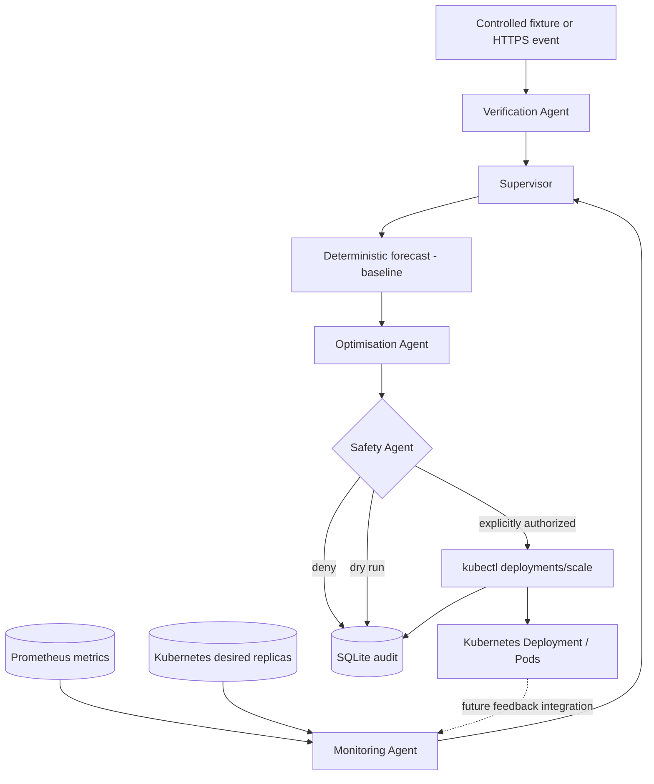

# Agentic Kubernetes Foundation — first working integration milestone

**Project:** Event-Aware Agentic AI for Efficient Cloud Resource Management (aligned to the minor-project synopsis).

This directory can be copied into your existing Java/Maven project as a **separate** subdirectory. It does not overwrite or modify your existing CloudSim modules. The old CloudSim benchmarks remain a simulation baseline, not evidence of Kubernetes HPA performance.

## What is real in this milestone

- A small **supervisor control loop** with verification, monitoring, deterministic demand forecasting, planning, safety decisions, a real `kubectl scale` executor, and an SQLite decision log.
- **Optional live telemetry** from the Prometheus HTTP API and deployment replica count from Kubernetes. The Prometheus endpoint and instrumented metrics must be configured.
- An optional **real Kubernetes write path**, gated by explicit CLI opt-in and Kubernetes RBAC. It requests a Deployment replica-count change via the Kubernetes API. No real cluster test is claimed here.
- A small FastAPI portal application, Dockerfile, example Deployment and Service, and a narrowly-scoped service-account Role.
- **12 automated local tests** of the control loop and its safety behavior.

## Not yet completed (important)

1. End-to-end **live-cluster verification** and post-action observation / rollback. `REQUESTED` only means a request was sent, **not** that extra Pods became ready.
2. The Java Gemini / event-intelligence pipeline is **not wired to the new Python supervisor yet**. Current forecast is deterministic; do **not** claim the LLM drives the live scaling decision.
3. A measured Kubernetes **HPA baseline** with Locust-generated identical workloads and appropriate CPU/request metrics.
4. Heterogeneous **arm64 worker** runtime validation. An amd64 node selector is provided, but no arm64 Pod deployment or hardware validation is claimed.
5. SLO measurement, statistically repeated experiments, sustained workload, and cost-aware optimisation/scale-down.
6. Source evidence verification is an intentionally strict exact-excerpt/timestamp check, not a complete semantic verifier or protection against hostile website compromise. In deployed systems, also constrain outbound network access.

## Prerequisites

Windows PowerShell or Bash, Python 3.11+, `kubectl`, Docker (for the demo), an authorized Kubernetes context, and optionally Prometheus. For local tests only Python 3.11+ and pytest are required.

## Windows local dry-run (no cluster, no network)

```powershell
cd "C:\Users\hp\IdeaProjects\HetrogeniousResourceAllocation\agentic-k8s"
py -3 -m venv .venv
.\.venv\Scripts\Activate.ps1
python -m pip install -e ".[test]"
python -m pytest -q
python -m agentic_k8s.cli
```

Expected fixture output: `WARNING: using CONTROLLED local evidence fixture`, with `status: DRY_RUN`. This fixture is NOT an authenticated university notice.

## Kubernetes demo application (requires a working cluster)

```powershell
# Build the app container; make it available in your Kubernetes node image registry.
docker build -t agentic-demo-portal:0.1 .\demo

# Create namespace and restricted service-account Role.
kubectl apply -f k8s\rbac.yaml

# Create the example application only after arranging image availability on the node.
kubectl apply -f k8s\portal.yaml
kubectl -n agentic-demo rollout status deployment/portal-amd64
kubectl -n agentic-demo get pods -o wide
kubectl -n agentic-demo port-forward service/portal 8080:80
```

You can visit `http://localhost:8080/` and `http://localhost:8080/metrics` in another terminal. `imagePullPolicy: IfNotPresent` only works when the image exists on the selected node or is accessible from its registry. For k3s, import the image into the k3s/containerd image store or use a reachable registry. The example Role is intended for the dedicated controller ServiceAccount; a local admin kubeconfig has greater permissions, so **do not treat the YAML alone as restricting an admin user**.

## Read-only live metrics test

You need a Prometheus server scraping the application `/metrics` endpoint (annotations are included but discovery configuration varies). The prototype expects `http_requests_total`, `http_request_duration_seconds_bucket`, and `portal_cpu_utilization_ratio` with `app="portal"`. With sufficient generated requests to populate the histogram, run:

```powershell
python -m agentic_k8s.cli --live-metrics --prometheus http://localhost:9090
```

This uses a controlled event fixture and **does not make Kubernetes changes**. You may first use `kubectl -n monitoring port-forward service/prometheus-server 9090:80` if that Service exists in your cluster; adjust the namespace/service/port based on your installation.

## Optional *real* scaling request (advanced, only on a disposable demo deployment)

To request a scale operation, you must explicitly supply `--execute`, `--live-metrics`, `--event-file`, and `--trusted-host`. The event-file must contain the JSON fields defined by `Event` and the source must be a configured allowlisted HTTPS site containing the exact quoted opening timestamp. The controller uses actual Prometheus telemetry and `kubectl` for this path.

```powershell
python -m agentic_k8s.cli --live-metrics --execute --event-file .\event.json --trusted-host notices.YOUR-UNIVERSITY-DOMAIN.example --namespace agentic-demo --deployment portal-amd64 --context YOUR_RESTRICTED_CONTEXT
```

**Do not run this with an administrator context or against production.** Only use a dedicated restricted Kubernetes ServiceAccount/context. The code checks bounds and max-step size, and `kubectl scale` checks the current replica count. It does not yet implement a durable cooldown, automatic rollback or exclusive HPA ownership. Do not enable HPA on the same Deployment while using this controller: the two controllers would fight over replicas.

## Trust and demonstration rules

- The CLI's default fabricated event is clearly marked **CONTROLLED** and is only for local dry-run demonstrations.
- Denied event evidence disables pre-event scaling; **reactive telemetry** can still trigger a plan.
- The LLM must not be allowed to directly generate arbitrary Kubernetes commands.
- Real-world production use would need egress policy, authentication, SLO-aware feedback, retries, circuit breaking, persistent cooldown, scale-in protection, secret management and deployment hardening.
- The existing CloudSim 190-test suite stays independent; adding this directory does not modify those tests.

## Architecture



## Future integration with existing Java agent code

The Java `KubernetesExecutionAgent` in the reviewed archive **only constructs a patch description and updates counters**. Do not present it as a validated Kubernetes API integration. In the next milestone, connect its approved `SafetyDecision` to a dedicated service interface or direct Kubernetes API implementation with explicit target and RBAC, then validate readiness, safety and rollback. The Python foundation provides a reference executable implementation, not a claim that the Java/Python pipeline is connected already.
